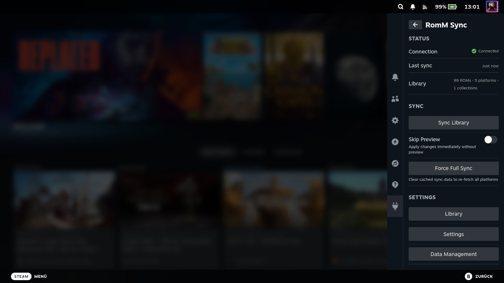
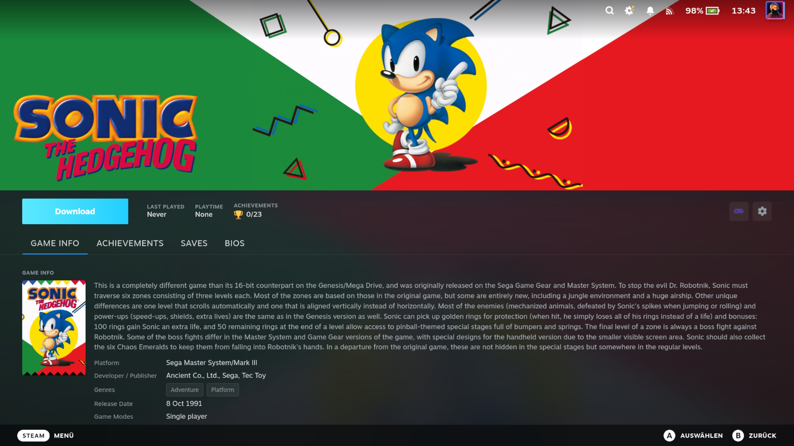
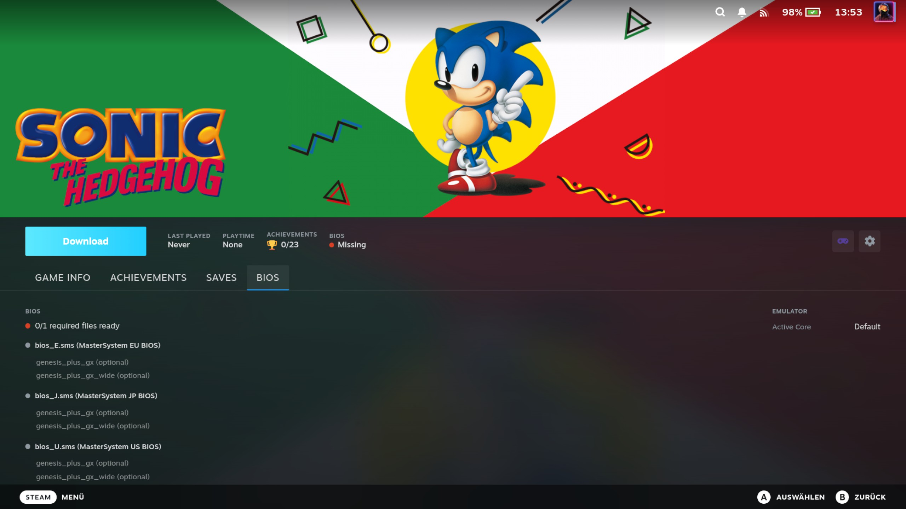
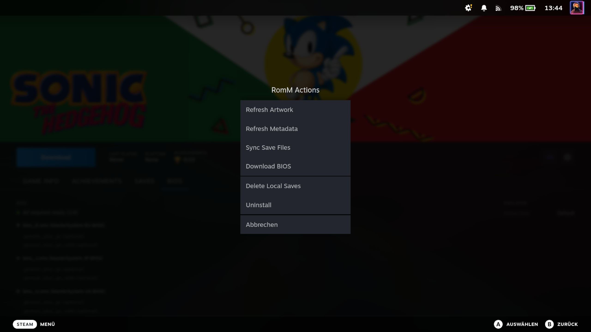

# Romm-emudecky

> **Fork** of [danielcopper/decky-romm-sync](https://github.com/danielcopper/decky-romm-sync) — ported from RetroDECK to
> EmuDeck.

A [Decky Loader](https://decky.xyz/) plugin that syncs your self-hosted [RomM](https://github.com/rommapp/romm) library
into Steam as non-steam shortcuts. Games appear directly in your Steam library, launch through EmuDeck, and keep their
saves in sync across devices through your RomM server.

## Features

- **Library sync** — Pulls platforms and ROMs from your RomM server and creates Steam shortcuts, complete with cover
  art, hero banners, and logos (with optional [SteamGridDB](https://www.steamgriddb.com/) artwork)
- **Save sync** — Keeps save files in sync across devices through your RomM server, with newest-wins conflict resolution
  and a manual override when you need it
- **ROM downloads** — Download ROMs on demand with progress tracking and a managed download queue
- **BIOS management** — Download firmware/BIOS files from RomM for systems that need them (PSX, Dreamcast, PS2, …)
- **Game detail page** — Install status, BIOS status, and download/uninstall actions right on each game's Steam page
- **Per-platform control** — Choose exactly which platforms get synced
- **Controller friendly** — Full gamepad navigation throughout the plugin UI
- **Steam Input config** — Per-shortcut Steam Input mode (Default / Force On / Force Off)
- **EmuDeck path migration** — Move your EmuDeck installation between storage locations without re-syncing
- **EmuDeck health diagnostics** — Detects misconfigured input drivers and EmuDeck configuration issues that break menu
  navigation

## Screenshots

|                                   QAM panel                                    |                                        Game detail page                                         |
| :----------------------------------------------------------------------------: | :---------------------------------------------------------------------------------------------: |
|                               |                             |
|                              **BIOS management**                               |                                      **Per-game actions**                                       |
|  |  |

## Requirements

- [Decky Loader](https://decky.xyz/) on your Steam Deck or Linux HTPC — the plugin lives in Steam's gamepad UI, so it
  works in the Deck's Game Mode **or** in Big Picture Mode on any Linux PC
- A running [RomM](https://github.com/rommapp/romm) server, **version 4.9.0 or newer** (the plugin stays inert against
  older servers)
- [EmuDeck](https://www.emudeck.com/) for launching games

## Installation

### From the Decky Store

> ⚠️ **Not available yet.** The plugin will be submitted to the [Decky Store](https://plugins.deckbrew.xyz/) with the
> **v1.0** release. Until then, use the manual install below.

Once published, install it straight from Decky's built-in store — open the Quick Access Menu → **Decky** → store icon,
search for **RomM Sync**, and install. No Developer Mode required.

### From ZIP or URL

This is the current method while v1.0 is in progress. It requires **Developer Mode** in Decky Loader (Decky settings →
gear icon → toggle **Developer Mode**).

1. Download the latest `decky-romm-sync.zip` from the
   [releases page](https://github.com/melikootje/Romm-emudecky/releases)
2. In Decky settings → **Developer** tab → **Install Plugin from ZIP** (or **from URL** with the
   [latest release link](https://github.com/melikootje/Romm-emudecky/releases/latest/download/decky-romm-sync.zip))

> Full step-by-step instructions, including first-time setup, are in
> [Getting Started](https://melikootje.github.io/Romm-emudecky/user-guide/getting-started/).

## Quick start

1. Open the Quick Access Menu and select **RomM Sync**
2. In **Settings**, enter your RomM server URL and credentials, then hit **Test Connection**
3. In **Platforms**, enable the platforms you want to sync
4. Hit **Sync Library** — your ROMs appear as non-steam shortcuts

See the [User Guide](https://melikootje.github.io/Romm-emudecky/user-guide/syncing-your-library/) for syncing details,
[save sync](https://melikootje.github.io/Romm-emudecky/user-guide/save-sync/), and
[BIOS management](https://melikootje.github.io/Romm-emudecky/user-guide/bios-management/).

## Contributing

Build from source, run the tests, and read the architecture reference on the documentation site:

- [Development setup](https://melikootje.github.io/Romm-emudecky/contributing/development/)
- [Frontend dev loop](https://melikootje.github.io/Romm-emudecky/contributing/frontend-dev-loop/) — live-reload the UI
  into a windowed Big Picture on the Deck, no Game Mode switching
- [Backend architecture](https://melikootje.github.io/Romm-emudecky/architecture/backend-architecture/)

## Acknowledgments

This plugin stands on the shoulders of some great projects:

- [danielcopper/decky-romm-sync](https://github.com/danielcopper/decky-romm-sync) — the upstream project this is forked
  from. Its RetroDECK integration was the foundation; this fork replaces the host layer with EmuDeck.
- [RomM](https://github.com/rommapp/romm) — the self-hosted ROM manager at the heart of this plugin. RomM provides the
  library, metadata, cover art, and save file storage that makes the entire sync experience possible
- [EmuDeck](https://www.emudeck.com/) — the all-in-one emulation solution for Steam Deck that bundles ES-DE, RetroArch,
  and standalone emulators with launcher scripts. Our entire launch chain runs through EmuDeck
- [Decky Loader](https://decky.xyz/) — the plugin framework that makes all of this possible
- [Valve](https://www.valvesoftware.com/) — for the Steam Deck, SteamOS, and an open enough platform to build on
- [Unifideck](https://github.com/ma3ke/unifideck) — inspiration for game detail page injection techniques and gamepad
  navigation patterns
- [MetaDeck](https://github.com/EmuDeck/MetaDeck) — inspiration for store patching patterns used in metadata display on
  non-Steam shortcuts
- [Argosy](https://github.com/rommapp/argosy-launcher) — RomM's Android device-sync client. Its baseline-anchored
  save-conflict handling — client-side detection layered over RomM's negotiate transport, with a keep-local/keep-remote
  prompt on genuine divergence — validated the posture this plugin's save sync takes
- [Grout](https://github.com/rommapp/grout) — RomM's Linux handheld client. Its 409-driven upload reconciliation (POST
  with overwrite=false, downgrading to a download when the local save is unchanged and surfacing a conflict when it
  diverged) informed this plugin's negotiate upload and conflict path

## License

GPL-3.0
